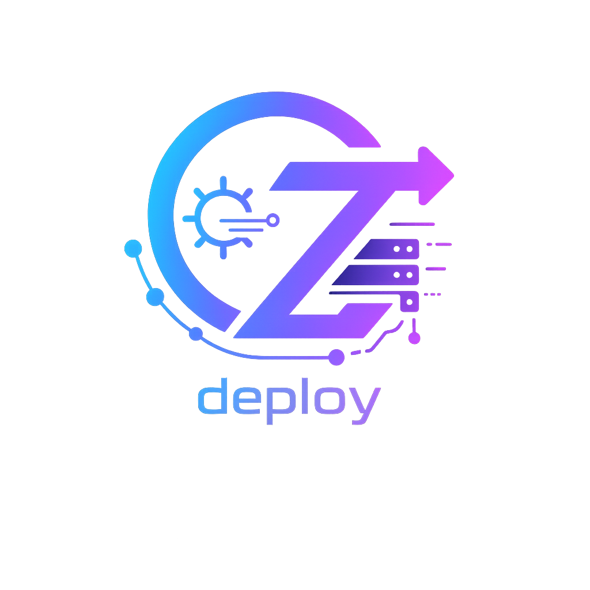

<a id="readme-top"></a>

<!-- PROJECT SHIELDS -->
<p align="center">
  <a href="https://github.com/OurNeZt/OurNeZt-deploy/actions/workflows/ci.yaml">
    
  </a>
  <a href="https://github.com/OurNeZt/OurNeZt-deploy/releases">
    
  </a>
  <a href="https://github.com/OurNeZt/OurNeZt-deploy/blob/stable/LICENSE">
    
  </a>
  <a href="https://github.com/OurNeZt/OurNeZt-deploy/pkgs/container/ournezt">
    
  </a>
</p>

<!-- PROJECT LOGO -->
<br />
<div align="center">
  <a href="https://github.com/OurNeZt/OurNeZt-deploy">
    
  </a>

  <p align="center">
    Deployment and runtime orchestration repository for the OurNeZt platform.
    <br />
    <br />
    <a href="https://github.com/OurNeZt/OurNeZt-deploy/issues/new?labels=bug&template=bug_report.md">Report Bug</a>
    &middot;
    <a href="https://github.com/OurNeZt/OurNeZt-deploy/issues/new?labels=enhancement&template=feature_request.md">Request Feature</a>
    &middot;
    <a href="https://github.com/OurNeZt/OurNeZt-deploy/releases">Releases</a>
  </p>
</div>

---

<!-- TABLE OF CONTENTS -->
<details>
  <summary>Table of Contents</summary>
  <ol>
    <li>
      <a href="#about-the-project">About The Project</a>
      <ul>
        <li><a href="#what-it-does">What It Does</a></li>
        <li><a href="#built-with">Built With</a></li>
      </ul>
    </li>
    <li>
      <a href="#getting-started">Getting Started</a>
      <ul>
        <li><a href="#prerequisites">Prerequisites</a></li>
        <li><a href="#installation">Installation</a></li>
        <li><a href="#configuration">Configuration</a></li>
      </ul>
    </li>
    <li><a href="#running-the-service">Running The Service</a></li>
    <li><a href="#testing">Testing</a></li>
    <li><a href="#docker">Docker</a></li>
    <li><a href="#release-flow">Release Flow</a></li>
    <li><a href="#roadmap">Roadmap</a></li>
    <li><a href="#contributing">Contributing</a></li>
    <li><a href="#license">License</a></li>
    <li><a href="#contact">Contact</a></li>
  </ol>
</details>

---

## About The Project

**OurNeZt Deploy** is the deployment and environment orchestration repository for the OurNeZt ecosystem.

It provides:

- Local multi-service orchestration with Docker Compose.
- Kubernetes deployment through a unified Helm chart (`charts/ournezt`).
- CI/CD workflows for deployment config validation, linting, and release packaging.

This repository is focused on infrastructure and deployment assets only.

<p align="right">(<a href="#readme-top">back to top</a>)</p>

---

## What It Does

OurNeZt Deploy currently provides:

- Local stack startup for `OurNeZt-web`, `OurNeZt-core`, and PostgreSQL.
- Shared environment variable patterns for local runtime.
- Stateful PostgreSQL deployment in Kubernetes.
- Core and web app deployment wiring with internal service discovery.
- Optional ingress configuration for web exposure.
- Core and Web 2.0 transport configuration, persistent CSRF secrets, and HTTP request limits.
- GitHub Actions workflows for compose validation, Helm lint/template checks, and chart release packaging.

---

## Built With

<p align="left">
  
  
  
  
  
  
</p>

<p align="right">(<a href="#readme-top">back to top</a>)</p>

---

## Getting Started

### Prerequisites

Install the following tools:

- Docker
- Docker Compose v2
- Helm 3 or 4 (CI validates 3.16.2 and 4.3.0)
- kubectl (for Kubernetes deployments)

Optional but recommended:

- `make`

---

### Installation

Clone the repository:

```bash
git clone git@github.com:OurNeZt/OurNeZt-deploy.git
cd OurNeZt-deploy
```

Prepare local env:

```bash
cp .env.example .env
```

<p align="right">(<a href="#readme-top">back to top</a>)</p>

---

## Configuration

Configuration is handled through:

- `.env` for local Docker Compose runs.
- `values.yaml` / `values-*.yaml` for Helm deployments.

The defaults in `.env.example` run Core and Web `v2.0.0` in development mode over local HTTP. Copy it to `.env` and replace the bootstrap password before creating an admin. New passwords require at least 15 characters, no whitespace, at most 1,024 UTF-8 bytes, and must not be common passwords.

Key local settings:

```bash
POSTGRES_DB=ournezt
POSTGRES_USER=ournezt
POSTGRES_PASSWORD=ournezt
POSTGRES_PORT=5432

CORE_IMAGE_TAG=v2.0.0
CORE_APP_ENV=development
CORE_GRPC_PORT=50051
CORE_SESSION_TOKEN_BYTES=32
CORE_SESSION_TTL=24h
CORE_AUTH_IP_LIMIT=120
CORE_AUTH_ACCOUNT_LIMIT=5
CORE_AUTH_RATE_WINDOW=1m
CORE_AUTH_MAX_CONCURRENT=2
CORE_RUN_MIGRATIONS=true
CORE_BOOTSTRAP_ADMIN_EMAIL=admin@example.com
CORE_BOOTSTRAP_ADMIN_PASSWORD=replace-with-a-unique-passphrase
CORE_BOOTSTRAP_ADMIN_DISPLAY_NAME=Admin

WEB_IMAGE_TAG=v2.0.0
WEB_APP_ENV=development
WEB_PORT=8080
WEB_SESSION_COOKIE_NAME=ournezt_session
WEB_SESSION_COOKIE_MAX_AGE=24h
WEB_SESSION_COOKIE_SECURE=false
WEB_REQUEST_TIMEOUT=5s
WEB_AUTH_IP_LIMIT=30
WEB_AUTH_ACCOUNT_LIMIT=5
WEB_AUTH_RATE_WINDOW=1m
WEB_AUTH_MAX_CONCURRENT=8
# Comma-separated reverse proxy IPs or CIDRs; leave empty for direct access.
WEB_TRUSTED_PROXIES=
WEB_MAINTENANCE_NOTICE_ENABLED=false
WEB_MAINTENANCE_NOTICE_LEVEL=warning
WEB_MAINTENANCE_NOTICE_TITLE=
WEB_MAINTENANCE_NOTICE_MESSAGE=
WEB_MAINTENANCE_NOTICE_STARTS_AT=
WEB_MAINTENANCE_NOTICE_ENDS_AT=
```

For production, prefer Kubernetes Secrets instead of inline passwords in Helm values.

Helm chart `0.4.0` pins Core and Web `v2.0.0`. Override `core.image.tag` and `web.image.tag` in your environment values when needed. Compose supports `CORE_IMAGE_TAG` and `WEB_IMAGE_TAG`. Deployment repository releases and Helm chart versions are independent of application versions.

The base chart uses `global.appEnv=production` and deliberately requires explicit transport and CSRF settings. Rendering without those settings fails with a configuration error rather than installing pods that cannot start. Use `examples/values-production.yaml` with pre-created Secrets for verified TLS, or `examples/values-development.yaml` for local HTTP testing.

Authentication limits are configurable through `core.authLimits` and `web.authLimits` in Helm, or the `CORE_AUTH_*` and `WEB_AUTH_*` Compose variables. Defaults match the released applications: Core allows 120 requests per peer IP, 5 per account, and 2 concurrent password operations; Web allows 30 requests per browser IP, 5 per account, and 8 concurrent authentication requests. Both use a 1-minute window. Limits recover automatically and are independent per process/replica.

Set Helm `web.trustedProxies` to a list of the actual ingress/reverse proxy IPs or CIDRs, or set Compose `WEB_TRUSTED_PROXIES` to a comma-separated list. Leave it empty for direct access. Without trusted proxy configuration, browsers behind the same proxy share its IP budget.

Maintenance notices can be configured in Helm under `web.maintenanceNotice`. The chart mounts the notice as a ConfigMap-backed JSON file, so banner copy can be updated with `kubectl edit configmap <release>-web-maintenance-notice` without rebuilding the web image.

### Web 2.0 runtime settings

| Purpose | Helm value | Compose variable |
| --- | --- | --- |
| Persistent CSRF secret | `web.csrf.existingSecret` and `web.csrf.key`, or `web.csrf.authKey` | `WEB_CSRF_AUTH_KEY` |
| Core TLS certificate and key | `core.tls.*` | `CORE_GRPC_TLS_CERT_FILE`, `CORE_GRPC_TLS_KEY_FILE` plus read-only mounts |
| Verified Web-to-Core TLS | `web.coreGrpcTLS.*` | `WEB_CORE_GRPC_USE_TLS`, `WEB_CORE_GRPC_TLS_CA_FILE`, `WEB_CORE_GRPC_TLS_SERVER_NAME` |
| Explicit trusted plaintext hop | `core.allowInsecure`, `web.coreAllowInsecure` | `CORE_GRPC_ALLOW_INSECURE`, `WEB_CORE_ALLOW_INSECURE` |
| Shared Core request deadline | `web.requestTimeout` | `WEB_REQUEST_TIMEOUT` (default `5s`) |
| Graceful shutdown | `web.shutdownTimeout` | `WEB_SHUTDOWN_TIMEOUT` (default `10s`) |
| HTTP header/read/write/idle limits | `web.httpLimits.*Timeout` | `WEB_READ_HEADER_TIMEOUT`, `WEB_READ_TIMEOUT`, `WEB_WRITE_TIMEOUT`, `WEB_IDLE_TIMEOUT` |
| Global request body limit | `web.httpLimits.maxRequestBodyBytes` | `WEB_MAX_REQUEST_BODY_BYTES` (default 1 MiB) |

HTTP timeouts default to `10s`, `15s`, `30s`, and `60s`, respectively. Keep the write timeout longer than the Core request deadline so Web can send a timeout response. Authentication forms retain their smaller 16 KiB cap even if the global limit is raised. Configure ingress body/read/write limits consistently with the application.

### Production Helm configuration

Generate the CSRF key once, retain it across upgrades, and share it across every Web replica. The key must contain exactly 64 hexadecimal characters. For example, create a Secret from a private file without storing the key in Git:

```bash
mkdir -p secrets
openssl rand -hex 32 | tr -d '\n' > secrets/csrf-auth-key
kubectl create namespace ournezt
kubectl -n ournezt create secret generic ournezt-web-csrf \
  --from-file=CSRF_AUTH_KEY=secrets/csrf-auth-key
```

For the verified TLS example, provision a Core server certificate whose DNS SAN matches `ournezt-ournezt-core` (the default Service for release name `ournezt`). Adjust `web.coreGrpcTLS.serverName` if the release name, fullname, or certificate identity differs. Prepare the certificate, private key, and issuing CA locally, then create their Secrets:

```bash
kubectl -n ournezt create secret tls ournezt-core-tls \
  --cert=tls/core/tls.crt --key=tls/core/tls.key
kubectl -n ournezt create secret generic ournezt-core-ca \
  --from-file=ca.crt=tls/ca/ca.crt
```

Set an ingress class, replace `app.example.com`, and provision the referenced browser-facing `ournezt-web-tls` Secret using your certificate-management process. Supply a strong PostgreSQL password through an existing Secret or private values as described in `postgres.auth`. Keep existing database credentials when upgrading a persistent PostgreSQL volume; changing the value does not rotate the stored database password.

`web.csrf.authKey` is an alternative chart-managed Secret. Supply it through private values, never commit it. Changing that value changes the Web pod checksum and rolls the deployment. Helm never generates or rotates this key automatically. When changing an externally managed CSRF Secret or a TLS/CA Secret, explicitly restart the affected deployments after updating the Secret; running processes read these settings at startup. CSRF rotation invalidates open forms.

For an intentionally trusted plaintext Web-to-Core hop, set both `core.allowInsecure=true` and `web.coreAllowInsecure=true`, leave both TLS switches disabled, and still configure CSRF and browser-facing HTTPS. Neither service permits plaintext automatically in production. Restrict this hop to the trusted network; the chart does not create network isolation. Certificate verification bypass is forbidden in production. For an external Core or TLS proxy, set `web.coreGrpcAddr` and configure Web's TLS verification for that endpoint.

### Browser HTTPS and security headers

Web 2.0 sets CSP, frame protection, MIME sniffing protection, referrer policy, and permissions policy itself. Preserve these headers at ingress, especially the CSP nonce; do not add a second conflicting CSP. The chart serves HTTP behind ingress, so the ingress must redirect public HTTP to HTTPS and send `Strict-Transport-Security: max-age=31536000` on every public HTTPS response, including ingress-generated errors. Configure those policies in the selected ingress controller. Merely setting an Ingress TLS Secret does not configure every controller's redirect/HSTS behavior. Forwarded protocol headers do not cause the backend to emit HSTS.

Keep `web.sessionCookieSecure="true"` in production and preserve the original public Host for CSRF validation. Set trusted proxy addresses only for the real ingress sources. Assets are now self-hosted; no CDN allowlist or runtime Node.js service is required.

---

## Running The Service

Run the released stack (Core and Web `v2.0.0`):

```bash
docker compose pull
docker compose up -d
```

For local source development, clone `OurNeZt-core` and `OurNeZt-web` alongside this repository and use the build override:

```bash
docker compose -f docker-compose.yml -f docker-compose.build.yml up -d --build
```

The override uses local image names so source builds do not replace the released image tags.

Check logs:

```bash
docker compose logs -f postgres core web
```

Access:

- Web: `http://localhost:8080`
- Core gRPC: `localhost:50051`
- PostgreSQL: `localhost:5432`

Deploy to Kubernetes:

```bash
helm upgrade --install ournezt ./charts/ournezt \
  --namespace ournezt \
  --create-namespace \
  -f examples/values-production.yaml \
  -f values-private.yaml
```

<p align="right">(<a href="#readme-top">back to top</a>)</p>

---

### Production Compose with verified Core TLS

Prepare `tls/core/tls.crt`, `tls/core/tls.key`, and `tls/ca/ca.crt`; the server certificate must include the DNS name `core`. Ensure the non-root container user (UID 10001) can read the mounted key. The TLS override mounts only the server credentials into Core and only the CA into Web, all read-only. It refuses to create missing host directories.

Set `CORE_APP_ENV=production`, `WEB_APP_ENV=production`, `WEB_SESSION_COOKIE_SECURE=true`, and a persistent `WEB_CSRF_AUTH_KEY` in the private `.env`, then run:

```bash
docker compose -f docker-compose.yml -f docker-compose.tls.yml config --quiet
docker compose -f docker-compose.yml -f docker-compose.tls.yml up -d
```

The override supplies all container TLS paths and enables certificate verification. You must separately provide the public HTTPS reverse proxy with redirects, HSTS, and Host preservation as described above; the Web container still listens on HTTP. Keep database/Core ports private in production. For a deliberately trusted plaintext hop without the TLS override, set both `CORE_GRPC_ALLOW_INSECURE=true` and `WEB_CORE_ALLOW_INSECURE=true` explicitly.

### Upgrading to Core and Web v2.0.0

Back up PostgreSQL before upgrading. Core 2.0 adds migration `000008_resource_limits`, on top of migrations 6 and 7 from the preceding release. Run it before Core 2.0 serves traffic. Automatic migrations remain enabled through `core.runMigrations` / `CORE_RUN_MIGRATIONS`; if disabled, apply migrations separately first. Audit legacy oversized fields and over-quota collections and validate the new length/JSON checks after repairing them. Rolling back the migration does not restore credential rows already removed by retention.

Prepare the CSRF Secret, TLS/CA Secrets or explicit plaintext opt-ins, browser HTTPS policy, and compliant bootstrap credentials before rollout. Upgrade Core first and verify migration completion and service readiness, then upgrade Web. Core provides the new session revocation RPC; Web requires it for successful logout. Password changes now revoke all sessions and require a fresh login.

With Helm, first use the new chart and environment values while keeping `web.image.tag` at the currently deployed Web tag (for example `v1.4.0`). Confirm Core is healthy, then upgrade again with `web.image.tag=v2.0.0`. A single upgrade can roll both Deployments concurrently. If enabling Core TLS during the upgrade, coordinate the transport switch with Web or a maintenance window because older Web pods may still use plaintext.

With Compose, pull both images, stop Web if changing the Core transport, update PostgreSQL/Core, inspect Core logs for migration/startup success, then update Web. Include the same TLS override in each command if using it:

```bash
docker compose -f docker-compose.yml -f docker-compose.tls.yml pull
docker compose -f docker-compose.yml -f docker-compose.tls.yml stop web
docker compose -f docker-compose.yml -f docker-compose.tls.yml up -d postgres core
docker compose -f docker-compose.yml -f docker-compose.tls.yml logs core
# After confirming Core is ready:
docker compose -f docker-compose.yml -f docker-compose.tls.yml up -d web
```

**Pagination limitation:** Core 2.0 defaults affected list APIs to 50 records. Web 2.0 does not yet follow `next_page_token`, so later records, including housing options in comparisons, can be omitted. Helm or Compose settings cannot repair this client behavior. Update Web pagination before rollout where any affected collection exceeds 50 records.

Core also enforces resource quotas (including 100 housing options and 50 checklist criteria per family), field limits, and a 1 MiB gRPC message cap. Expired/revoked/used credentials are cleaned in bounded batches after seven days; financial history is not automatically pruned. See the Core 2.0 release notes for the full limits and migration details.

## Testing

Validate compose config:

```bash
docker compose --env-file .env.example -f docker-compose.yml config
docker compose --env-file .env.example -f docker-compose.yml -f docker-compose.build.yml config
docker compose --env-file .env.example -f docker-compose.yml -f docker-compose.tls.yml config
```

Lint and render Helm chart:

```bash
helm lint ./charts/ournezt -f examples/values-production.yaml
helm template ournezt ./charts/ournezt -f examples/values-production.yaml > /dev/null
helm lint ./charts/ournezt -f examples/values-development.yaml
```

Run deployment regression checks (Python 3 and PyYAML, Helm, and Docker Compose; no daemon or cluster required):

```bash
python -m pip install PyYAML
python -m unittest discover -s tests -v
```

Run GitHub workflow lint checks locally (optional):

```bash
yamllint -c .yamllint .github/workflows docker-compose*.yml examples charts/ournezt/Chart.yaml charts/ournezt/values.yaml
```

<p align="right">(<a href="#readme-top">back to top</a>)</p>

---

## Docker

Start:

```bash
docker compose up -d
```

Stop:

```bash
docker compose down
```

Reset volumes (destructive):

```bash
docker compose down -v
```

<p align="right">(<a href="#readme-top">back to top</a>)</p>

---

## Release Flow

This repository uses a controlled release flow:

```text
dev -> release/vX.Y.Z -> stable
```

The release process is:

1. Run the `prepare-release` workflow manually.
2. Select the version bump type: `patch`, `minor`, or `major`.
3. The workflow creates a `release/vX.Y.Z` branch and updates `CHANGELOG.md`.
4. Review and update the generated changelog entry.
5. Merge the release PR into `stable`.
6. The `release` workflow creates the Git tag, GitHub Release, and packaged Helm chart artifact.

<p align="right">(<a href="#readme-top">back to top</a>)</p>

---

## Roadmap

- [x] Unified Helm chart for web, core, and PostgreSQL
- [x] Local docker compose stack for web, core, and PostgreSQL
- [x] CI validation for compose and Helm rendering
- [x] Release workflow for Helm packaging
- [x] Production/development Helm examples and a verified Core TLS Compose override
- [ ] Optional migration Job/Hook strategy for Kubernetes
- [ ] Secret manager integration patterns (external-secrets / sealed-secrets)
- [ ] Observability deployment add-ons (metrics, dashboards, alerts)

See the [open issues](https://github.com/OurNeZt/OurNeZt-deploy/issues) for planned improvements and known issues.

<p align="right">(<a href="#readme-top">back to top</a>)</p>

---

## Contributing

Contributions are welcome.

For normal development:

1. Create a feature branch from `dev`.

   ```bash
   git checkout dev
   git pull
   git checkout -b feature/your-feature-name
   ```

2. Make your changes.

3. Run validations.

   ```bash
   docker compose --env-file .env.example -f docker-compose.yml config
   docker compose --env-file .env.example -f docker-compose.yml -f docker-compose.build.yml config
   helm lint ./charts/ournezt -f examples/values-production.yaml
   helm template ournezt ./charts/ournezt -f examples/values-production.yaml > /dev/null
   ```

4. Commit using conventional commit style.

   ```bash
   git commit -m "feat: add deployment capability"
   ```

5. Open a pull request into `dev`.

For release preparation, use the release workflow instead of manually creating tags.

<p align="right">(<a href="#readme-top">back to top</a>)</p>

---

## License

Distributed under the Apache License 2.0. See `LICENSE` for more information.

<p align="right">(<a href="#readme-top">back to top</a>)</p>

---

## Contact

Project Organisation: [OurNeZt](https://github.com/OurNeZt)

Repository: [https://github.com/OurNeZt/OurNeZt-deploy](https://github.com/OurNeZt/OurNeZt-deploy)

<p align="right">(<a href="#readme-top">back to top</a>)</p>
